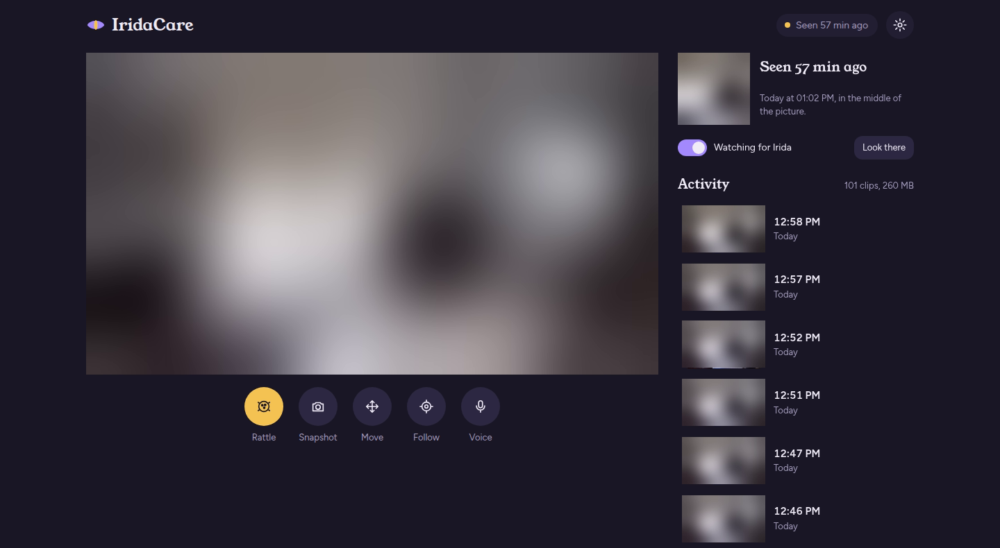

# IridaCare

**A self-hosted pet camera app for TP-Link Tapo pan/tilt cameras.** It watches for your cat, records a clip
every time she shows up, follows faces, hands or anything you name, and plays a toy rattle through the
camera speaker. Everything runs on your own computer and talks only to the camera on your LAN. No cloud,
no subscription.



*The camera image is blurred here for privacy. In the app it shows the live view.*

Built for Irida, a cat (Irida is Greek for iris), and tested with a Tapo C211.

## Features

- **Live view** in SD or HD, full screen, with pan/tilt controls
- **Cat detection** with YOLO26 on the CPU, which keeps the camera still and remembers where the cat was last seen
- **Automatic clips**: records whenever the cat is in view, starting a few seconds before she appears and ending 30 s after she leaves
- **Follow mode**: the camera tracks a face, a hand, or anything you type ("red ball", "dog"), using MediaPipe and YOLOE open-vocabulary detection
- **Toy rattle**: plays a rattle through the camera speaker to call the cat, or upload a recording of her own toy
- **Voice assistant** (optional): talk to the camera through OpenAI's Realtime API. It can move the camera, follow things and look for the cat
- **Camera settings**: privacy mode, status light, and nod/shake gestures
- **Local only**: the web UI listens on `127.0.0.1`; detection runs on your machine

## How to use it

Open the app in your browser (by default http://127.0.0.1:8080).

| Control | What it does |
|---|---|
| **Watching for Irida** (switch, right panel) | Turns cat detection and automatic clip recording on or off |
| **Seen … ago** / **Look there** | Shows when and where the cat was last spotted; **Look there** turns the camera to that spot |
| **Activity** | Lists recorded clips. Click one to play it, or delete it from the player |
| **Rattle** | Plays the toy rattle through the camera speaker |
| **Snapshot** | Downloads a still image of the current view |
| **Move** | Opens pan/tilt arrows with a speed slider |
| **Follow** | Pick **A face** or **A hand**, or type what to follow and press **Find**. **Stop** ends it |
| **Voice** | Starts a voice conversation with the camera (needs `OPENAI_API_KEY`) |
| **SD / HD** | Switches stream quality. SD uses less bandwidth on phones |
| **Settings** (top right) | Privacy mode, status light, nod/shake gestures, and uploading your own toy sound |

**Tips**

- **Phone or remote access:** the app only listens on `127.0.0.1`. To reach it from your phone, put it behind
  something like `tailscale serve` and add that hostname to `TAPO_EXTRA_HOSTS` in `.env`.
- **Your own toy sound:** record the cat's favourite toy and upload it in Settings, or save it as
  `sounds/rattle.wav` (`.mp3`, `.m4a` and `.ogg` also work).
- **Detecting a cat across the room** needs the medium model (`yolo26m`). Smaller models missed a cat only
  about 80 px wide.
- **Night vision:** infrared frames get their contrast boosted before detection, so detection works in the dark.

## Requirements

- A Tapo pan/tilt camera with a **camera account** set up (Tapo app → camera → Advanced settings → Camera account)
- Python 3.12
- `ffmpeg` on your `PATH`
- [go2rtc](https://github.com/AlexxIT/go2rtc/releases) at `bin/go2rtc` (only for the speaker: rattle and voice)
- Optional: an NVIDIA GPU with PyTorch for YOLOE (Follow → anything you type)
- Optional: an OpenAI API key for the voice assistant

## Installation

```bash
git clone https://github.com/ChRotsides/IridaCare.git
cd IridaCare
python3 -m venv .venv
.venv/bin/pip install -r requirements.txt
cp .env.example .env    # then fill in your camera's IP and login
```

Download the models into `models/`:

```bash
mkdir -p models/yolo
base=https://storage.googleapis.com/mediapipe-models
curl -L -o models/hand_landmarker.task          $base/hand_landmarker/hand_landmarker/float16/latest/hand_landmarker.task
curl -L -o models/blaze_face_short_range.tflite $base/face_detector/blaze_face_short_range/float16/latest/blaze_face_short_range.tflite

# Cat detection model: export YOLO26 to ONNX with Ultralytics
pip install ultralytics
yolo export model=yolo26m.pt format=onnx && mv yolo26m.onnx models/yolo/
```

For YOLOE (following anything you type), create a second venv, `.venv-gpu`, with PyTorch and
`requirements-gpu.txt`. Ultralytics downloads the YOLOE weights the first time they're used.

## Running

```bash
./run.sh        # Linux/macOS
run.bat         # Windows
```

Then open http://127.0.0.1:8080 (or the port set in `TAPO_PORT`).

## Configuration

All settings go in `.env`. See [`.env.example`](.env.example).

| Variable | Required | Purpose |
|---|---|---|
| `TAPO_HOST` | yes | Camera IP address on your LAN |
| `TAPO_USER`, `TAPO_PASSWORD` | yes | The camera account login |
| `TAPO_CLOUD_PASSWORD` | for speaker | Your Tapo cloud password. Needed for the speaker, and for privacy mode or the status light if the camera account is rejected |
| `TAPO_PORT` | no | Web UI port (default 8080) |
| `OPENAI_API_KEY` | for voice | Enables the voice assistant |
| `TAPO_EXTRA_HOSTS` | no | Extra hostnames to accept, comma-separated |

Recorded clips go to `clips/` and sightings to `sightings/`. Both stay on your machine.

## License

IridaCare is free software under the [GNU Affero General Public License v3.0](LICENSE).
You can use, change and share it, including commercially. If you distribute a modified version,
or run one as a network service for others, you must publish its source under the same license.

Copyright (C) 2026 Charalambos Rotsides

Third-party parts:
- [Ultralytics](https://github.com/ultralytics/ultralytics) (YOLO26, YOLOE): AGPL-3.0
- `sounds/rattle.wav`: excerpt of ["metal toy marble in a plastic ball, bouncing around"](https://freesound.org/people/ginacollecchia/sounds/208679/) by ginacollecchia, [CC BY 3.0](https://creativecommons.org/licenses/by/3.0/)
- MediaPipe models: Apache 2.0

Not affiliated with or endorsed by TP-Link. Tapo is a trademark of TP-Link.
